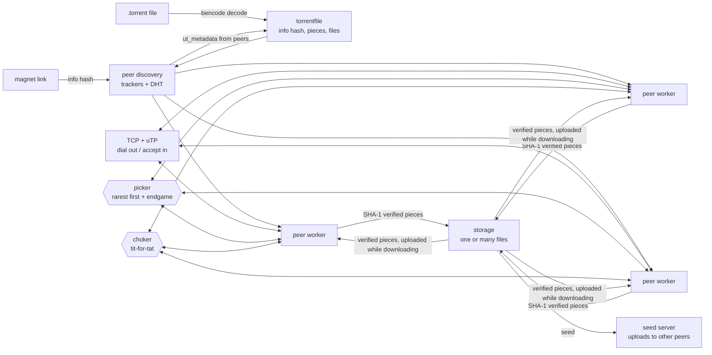

# ⚡ mini-bittorrent

<p align="center">
  
  
  <a href="https://github.com/AMINA-ELHASNAOUY/mini-bittorrent/actions/workflows/ci.yml"></a>
  
</p>

<p align="center">
  <i>A BitTorrent client written from the protocol spec in Go — standard library only, no torrent libraries.</i>
</p>

Give it a `.torrent` file or a `magnet:` link. It finds peers through HTTP/UDP trackers and the Mainline DHT,
fetches the torrent's metadata from peers when starting from a magnet link, downloads pieces from many peers in
parallel (rarest first, with an endgame mode), checks every piece against its SHA-1 hash, drops peers that send
corrupt data and resumes interrupted downloads. While downloading it uploads the pieces it already has, giving
its upload slots to the peers that upload to it fastest (tit-for-tat). It talks to peers over TCP and over
uTP, its own implementation of BitTorrent's UDP transport with LEDBAT congestion control, and can keep seeding
afterwards, running a full DHT node on the same port so even trackerless torrents can be found.

```text
$ mini-bittorrent demo
demo: local tracker + 4 seeders (one full, two partial, one sending corrupt data)
→ demo.bin (file, 8.0 MiB, 32 pieces)
→ asking 1 tracker(s) for peers…
  4 peers from trackers
→ connecting to 4 peers (TCP + uTP), accepting peers on port 42173
  15:50:10 peer 127.0.0.1:37673: piece 3 failed the hash check (1/3)
  15:50:10 peer 127.0.0.1:37673: piece 11 failed the hash check (2/3)
  15:50:10 peer 127.0.0.1:37673: piece 0 failed the hash check (3/3)
  15:50:10 peer 127.0.0.1:37673: dropped for sending corrupt data
  [██████████████████████████████] 100.0%  32/32 pieces  3 peers
✓ saved /tmp/mini-bittorrent-demo…/demo.bin, all 32 pieces SHA-1 verified (8.0 MiB downloaded in 847ms, 9.4 MiB/s)
✓ byte-for-byte identical to the original
```

## Quick start

```bash
git clone https://github.com/AMINA-ELHASNAOUY/mini-bittorrent.git
cd mini-bittorrent
go build -o mini-bittorrent .

./mini-bittorrent demo                          # full download from a local swarm, no internet needed
./mini-bittorrent info     file.torrent         # trackers, size, pieces, file list
./mini-bittorrent download file.torrent         # -o output path, -v peer logs, -seed keep seeding after
./mini-bittorrent download "magnet:?xt=urn:btih:…"   # no .torrent needed: metadata comes from peers
./mini-bittorrent seed     file.torrent path    # upload to other peers (-limit 500 caps it at 500 KiB/s)
```

Downloads accept peers on `-port` (default 6881, TCP and uTP) and upload while downloading; `-noupload` turns
that off, `-limit` caps upload speed, and `-noutp` sticks to TCP.

Interrupted? Run the same `download` command again: data lives in `<name>.part` until every piece is verified,
and pieces that are already on disk and valid are skipped.

To try it on the real network, use the `.torrent` or magnet link of a
[Debian](https://www.debian.org/CD/torrent-cd/) or [Ubuntu](https://ubuntu.com/download/alternative-downloads) image.
After a magnet download, the metadata is saved as `<name>.torrent` so you can resume or seed later without the link.

## How it works



| Package | What it does | Spec |
|---|---|---|
| `bencode` | Encoder/decoder for BitTorrent's binary serialization format | [BEP 3](https://www.bittorrent.org/beps/bep_0003.html) |
| `torrentfile` | Parses `.torrent` metadata (single- and multi-file, tracker tiers) and computes the info hash | BEP 3, [BEP 12](https://www.bittorrent.org/beps/bep_0012.html) |
| `tracker` | HTTP and UDP announce, compact, dictionary and IPv6 peer lists, all trackers queried in parallel | BEP 3, [BEP 7](https://www.bittorrent.org/beps/bep_0007.html), [BEP 15](https://www.bittorrent.org/beps/bep_0015.html), [BEP 23](https://www.bittorrent.org/beps/bep_0023.html) |
| `dht` | Iterative lookups, plus a full node: k-bucket routing table, answers `ping`/`find_node`/`get_peers`/`announce_peer`, token-protected peer store | [BEP 5](https://www.bittorrent.org/beps/bep_0005.html), [BEP 43](https://www.bittorrent.org/beps/bep_0043.html) |
| `magnet` | Parses magnet links (hex or base32 info hash, trackers, peers) | [BEP 9](https://www.bittorrent.org/beps/bep_0009.html) |
| `metadata` | Downloads the info dictionary from peers for magnet links | BEP 9, [BEP 10](https://www.bittorrent.org/beps/bep_0010.html) |
| `peer` | Handshake (both directions), wire messages, bitfields, extension protocol, the per-peer connection | BEP 3, BEP 10 |
| `utp` | uTP: reliable ordered streams over UDP, selective acks, retransmission, LEDBAT congestion control; shares its port with the DHT | [BEP 29](https://www.bittorrent.org/beps/bep_0029.html) |
| `download` | Rarest-first + endgame piece picker, request pipelining, hash verification, resume; uploads while downloading with a tit-for-tat choker | BEP 3 |
| `seed` | Serves verified pieces (and metadata) to incoming peers over TCP and uTP, with a choking algorithm and upload rate limit | BEP 3, BEP 9 |
| `storage` | Maps the torrent's byte stream onto files, splitting reads/writes at file boundaries | — |
| `internal/localswarm` | Local tracker, seeders and DHT node used by the tests and `demo` | — |

## Design decisions

- **One goroutine per peer, one shared picker.** Each worker asks the picker for the next piece its peer has. If the peer fails mid-transfer or sends data that fails the hash check, the piece is released for another peer. Nothing is ever lost when a peer disappears.
- **Rarest first.** The picker counts how many connected peers have each piece and hands out the rarest one first, so pieces held by few peers are secured before those peers leave.
- **Endgame mode.** When every missing piece is already in flight, idle peers download the same pieces in parallel; the first verified copy wins and the others are cancelled. A test shows a slow peer no longer holds up the last piece.
- **Request pipelining.** Each worker keeps up to 5 block requests (16 KiB each) in flight instead of waiting for every reply — round-trip latency, not bandwidth, is what limits a single connection. If a peer chokes us mid-piece, the dropped requests are re-sent after the next unchoke.
- **Peers without a tracker.** For magnet links the DHT is searched alongside the trackers; for `.torrent` files it's the fallback when trackers return nothing. The lookup walks towards the info hash by XOR distance, asking up to 8 nodes at a time.
- **Tit-for-tat while downloading.** Pieces are uploaded as soon as they are verified and on disk, on the same connections we download on, and incoming peers are accepted mid-download. Every 10 s the choker gives its 3 regular upload slots to the interested peers that sent us the most data in the last round, so peers that give back get more; one optimistic slot rotates every 30 s so newcomers with nothing to trade yet can get started. Anti-snubbing: a peer that hasn't sent us a block in 60 s loses its regular slot. When we finish we send NOT_INTERESTED and keep serving peers still mid-download for up to 15 s instead of hanging up on them.
- **uTP, from the spec.** BEP 29 on top of a plain UDP socket: 20-byte headers, connection IDs, in-order delivery with a reorder buffer, cumulative and selective acks (a packet with 3 later packets acked is resent at once), timeouts with the TCP RTT estimator and backoff. Congestion control is LEDBAT: the peer echoes how long our packets took; subtracting the lowest value of the last two minutes cancels the clock offset and leaves the queuing delay we cause, and the window grows below 100 ms of it and shrinks above. So a torrent yields to everything else on your connection. Packets stay under 1280 bytes, so no IP fragmentation.
- **TCP and uTP at once.** Outgoing connections try both at the same time and keep whichever connects first, so a peer that only speaks one of them costs no timeout. uTP and the DHT share one UDP port, as other clients expect: uTP packets are recognised by their first byte (type and version 1), DHT messages always start with `d`.
- **Upload to a few peers, not all.** Splitting upload bandwidth across everyone gives nobody a useful speed, so the seeder unchokes the peers it can send to fastest plus one *optimistic* slot that rotates every 30 s to give newcomers a chance, re-ranking every 10 s (or immediately when a slot frees up). A shared token bucket caps the total upload rate.
- **A good DHT citizen when seeding.** The seeder runs a full DHT node on its port: it answers other nodes' queries, keeps a k-bucket routing table, stores peers that announce themselves (only with a token bound to their IP, so nobody can register someone else's address), and re-announces itself every 15 minutes. Downloads use a read-only client, since a laptop behind NAT can't reliably answer queries.
- **Magnet = hash only.** The info dictionary is fetched from peers in 16 KiB pieces and only accepted if its SHA-1 matches the hash in the link, so a lying peer can't substitute a different torrent.
- **Never trust a peer.** Every piece is SHA-1 checked before it is written. A peer that sends 3 corrupt pieces is disconnected. Incoming lengths, indexes and block offsets are bounds-checked, and message and bencoded string lengths are capped so a malicious length prefix can't force a huge allocation.
- **Timeouts that don't corrupt the stream.** Workers read with deadlines (to notice new pieces while idle). If one fires halfway through a message, the bytes already received are kept and the next read finishes the message, instead of losing them and misreading everything after.
- **Every tracker at once.** All HTTP and UDP trackers are asked in parallel and their peers merged. Once one answers, slow or dead ones get a 3-second grace period instead of stalling the download. UDP requests are resent with a doubling timeout, since UDP packets can be lost.
- **Files are just offsets.** BitTorrent hashes one continuous byte stream, even for a folder. `storage` maps that stream onto the real files, so a piece that straddles two files is split transparently and the downloader never needs to know about files.
- **Safe output.** Pieces are written straight to their offset on disk, so memory stays flat regardless of size. Everything lands in `<name>.part` and is renamed only after a final full re-verification. File paths from the torrent are checked so a malicious `../` path can't write outside the download folder.
- **Resume by hashing, not bookkeeping.** On start, existing `.part` data is hashed piece by piece and anything valid is skipped. No state file can get out of sync with the data.
- **Testable without the internet.** `internal/localswarm` runs a real HTTP tracker and real peer-wire seeders on `127.0.0.1`, so the full path from announce to verified file is covered by tests.

## Tests

```bash
go test -race ./...
```

108 tests, run in CI with the race detector. Highlights:
- end-to-end downloads from local seeders: uneven last piece, a file split across two partial seeders, a multi-file folder written to disk
- two leechers that can each reach only a half-seeder: neither can finish alone, both finish by uploading to each other while downloading (one of them only reachable as an incoming connection)
- the tit-for-tat choker: the peer uploading to us fastest always keeps its slot, a snubbing peer loses it, the optimistic slot rotates, never more peers unchoked than allowed
- uTP: 4 MiB each way at once, 512 KiB over a link that drops 10%, duplicates 5% and reorders packets, FIN/EOF, RESET for a refused connection, dial timeouts, 8 connections on one socket, LEDBAT backing off when delay rises
- a full download over uTP only (our downloader against our seeder), and a dialer that reaches TCP-only and uTP-only peers
- a read deadline firing in the middle of a message, and a 4 GiB length prefix being rejected
- two corrupt seeders + one honest one: every bad piece is rejected, retried elsewhere, and the result verifies
- endgame: with one very slow peer, the fast peer finishes the slow peer's piece (the test fails if endgame is turned off)
- a seeder that chokes us every 3 blocks, a swarm missing a piece (stall detection), resume with a damaged piece
- magnet links resolved through a tracker, and through the DHT alone with no tracker at all
- a trackerless torrent seeded with the real `seed` code, announced into a local 6-node DHT, then found and downloaded by magnet link
- a 25-node local DHT network where one node announces and a fresh client finds it; forged tokens are rejected
- the choker never unchokes more peers than allowed and rotates the optimistic slot; the rate limit holds
- a fake DHT network the lookup has to walk across, a fake UDP tracker that drops packets and sends stray replies
- our own `seed` server feeding our own downloader, and malicious `.torrent` paths (`../`) being rejected

## Limitations

Being upfront about scope:
- uTP is tested against itself (including over a simulated lossy network), not yet against libutp/libtorrent
  peers on the real internet, so interoperability with other clients' uTP is unverified
- No protocol encryption (MSE/PE), so peers that require it won't connect
- Fetching magnet metadata uses TCP only
- Peers behind NAT can only reach us if the port is forwarded (no UPnP/NAT-PMP)
- After the download, `-seed` hands over to the seed server, which drops the existing connections; peers find
  it again through trackers and the DHT
- The DHT node simplifies bucket maintenance (it replaces stale nodes instead of pinging them first)

## Roadmap

- [x] Bencode, `.torrent` parsing, info hash
- [x] HTTP + UDP trackers, multiple trackers, IPv6 peers
- [x] Peer wire protocol, parallel downloads with pipelining
- [x] SHA-1 verification, corrupt-peer handling
- [x] Multi-file torrents
- [x] Resume interrupted downloads
- [x] Rarest-first piece selection and endgame mode
- [x] Seeding / upload support
- [x] Magnet links + DHT (BEP 9, BEP 10, BEP 5)
- [x] Seeder choking algorithm and upload rate limit
- [x] Full DHT node (answer queries, announce_peer)
- [x] Upload while downloading, with tit-for-tat
- [x] uTP transport (BEP 29)
- [ ] Test uTP against other clients on the real network
- [ ] Protocol encryption (MSE/PE)
- [ ] Port mapping (UPnP / NAT-PMP)

## License

MIT — see [LICENSE](LICENSE).

---

<p align="center"><sub>Built by <a href="https://github.com/AMINA-ELHASNAOUY">Amina Elhasnaouy</a></sub></p>
