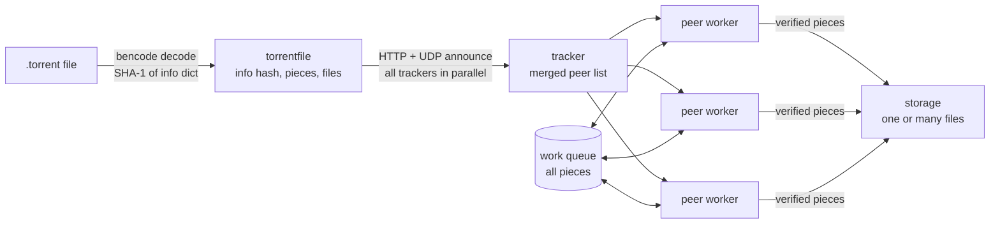

# ⚡ mini-bittorrent

<p align="center">
  
  
  <a href="https://github.com/AMINA-ELHASNAOUY/mini-bittorrent/actions/workflows/ci.yml"></a>
  
</p>

<p align="center">
  <i>A BitTorrent client written from the protocol spec in Go — standard library only, no torrent libraries.</i>
</p>

It reads a `.torrent` file, asks its HTTP and UDP trackers for peers, opens TCP connections to many of them at once,
downloads pieces in parallel, checks every piece against its SHA-1 hash, drops peers that send corrupt data,
writes single files or whole folders, and picks up where it left off if a download is interrupted.

```text
$ mini-bittorrent demo
demo: local tracker + 4 seeders (one full, two partial, one sending corrupt data)
→ demo.bin (file, 8.0 MiB, 32 pieces)
→ asking 1 tracker(s) for peers…
→ 4 peers from 1 tracker(s)
  15:08:41 peer 127.0.0.1:43615: piece 3 failed the hash check (1/3)
  15:08:41 peer 127.0.0.1:43615: piece 6 failed the hash check (2/3)
  15:08:41 peer 127.0.0.1:43615: piece 10 failed the hash check (3/3)
  15:08:41 peer 127.0.0.1:43615: dropped for sending corrupt data
  [██████████████████████████████] 100.0%  32/32 pieces  3 peers
✓ saved /tmp/mini-bittorrent-demo…/demo.bin, all 32 pieces SHA-1 verified (8.0 MiB downloaded in 840ms, 9.5 MiB/s)
✓ byte-for-byte identical to the original
```

## Quick start

```bash
git clone https://github.com/AMINA-ELHASNAOUY/mini-bittorrent.git
cd mini-bittorrent
go build -o mini-bittorrent .

./mini-bittorrent demo                      # full download from a local swarm, no internet needed
./mini-bittorrent info     file.torrent     # trackers, size, pieces, file list
./mini-bittorrent download file.torrent     # download it (-o to choose the output path, -v for peer logs)
```

Interrupted? Run the same `download` command again: data lives in `<name>.part` until every piece is verified,
and pieces that are already on disk and valid are skipped.

To try it on the real network, any `.torrent` with tracker URLs works — for example a
[Debian](https://www.debian.org/CD/torrent-cd/) or [Ubuntu](https://ubuntu.com/download/alternative-downloads) image.

## How it works



| Package | What it does | Spec |
|---|---|---|
| `bencode` | Encoder/decoder for BitTorrent's binary serialization format | [BEP 3](https://www.bittorrent.org/beps/bep_0003.html) |
| `torrentfile` | Parses `.torrent` metadata (single- and multi-file, tracker tiers) and computes the info hash | BEP 3, [BEP 12](https://www.bittorrent.org/beps/bep_0012.html) |
| `tracker` | HTTP and UDP announce, compact and dictionary peer lists, all trackers queried in parallel | BEP 3, [BEP 15](https://www.bittorrent.org/beps/bep_0015.html), [BEP 23](https://www.bittorrent.org/beps/bep_0023.html) |
| `peer` | Handshake, length-prefixed wire messages, bitfields, the per-peer connection | BEP 3 |
| `download` | Concurrent piece scheduler, request pipelining, hash verification, resume | — |
| `storage` | Maps the torrent's byte stream onto files, splitting reads/writes at file boundaries | — |
| `internal/localswarm` | Local tracker + seeders used by the tests and `demo` | — |

## Design decisions

- **One goroutine per peer, one shared work queue.** Every piece starts on a buffered channel. A worker takes a piece; if its peer doesn't have it, fails mid-transfer, or sends data that fails the hash check, the piece goes back on the queue for another peer. Nothing is ever lost when a peer disappears.
- **Request pipelining.** Each worker keeps up to 5 block requests (16 KiB each) in flight instead of waiting for every reply — round-trip latency, not bandwidth, is what limits a single connection.
- **Never trust a peer.** Every piece is SHA-1 checked before it is written. A peer that sends 3 corrupt pieces is disconnected. Incoming lengths, indexes and block offsets are bounds-checked, and bencoded string lengths are capped so a malicious length prefix can't force a huge allocation.
- **Every tracker at once.** All HTTP and UDP trackers are asked in parallel and their peers merged. Once one answers, slow or dead ones get a 3-second grace period instead of stalling the download. UDP requests are resent with a doubling timeout, since UDP packets can be lost.
- **Files are just offsets.** BitTorrent hashes one continuous byte stream, even for a folder. `storage` maps that stream onto the real files, so a piece that straddles two files is split transparently and the downloader never needs to know about files.
- **Safe output.** Pieces are written straight to their offset on disk, so memory stays flat regardless of size. Everything lands in `<name>.part` and is renamed only after a final full re-verification. File paths from the torrent are checked so a malicious `../` path can't write outside the download folder.
- **Resume by hashing, not bookkeeping.** On start, existing `.part` data is hashed piece by piece and anything valid is skipped. No state file can get out of sync with the data.
- **Testable without the internet.** `internal/localswarm` runs a real HTTP tracker and real peer-wire seeders on `127.0.0.1`, so the full path from announce to verified file is covered by tests.

## Tests

```bash
go test -race ./...
```

42 tests, run in CI with the race detector. Highlights:
- end-to-end downloads from local seeders: uneven last piece, a file split across two partial seeders, a multi-file folder written to disk
- two corrupt seeders + one honest one: every bad piece is rejected, retried elsewhere, and the result verifies
- resume: a half-written file with one damaged piece re-downloads only the missing and damaged pieces
- a fake UDP tracker that drops the first packet, sends stray replies and errors, to exercise retries
- malicious `.torrent` paths (`../`, separators) are rejected

## Limitations

Being upfront about scope:
- No magnet links or DHT: it needs a `.torrent` file with tracker URLs
- Download only: it does not seed back to the swarm
- IPv4 peers only, and pieces are requested in order rather than rarest-first

## Roadmap

- [x] Bencode, `.torrent` parsing, info hash
- [x] HTTP + UDP trackers, multiple trackers
- [x] Peer wire protocol, parallel downloads with pipelining
- [x] SHA-1 verification, corrupt-peer handling
- [x] Multi-file torrents
- [x] Resume interrupted downloads
- [ ] Rarest-first piece selection and endgame mode
- [ ] Seeding / upload support
- [ ] Magnet links + DHT (BEP 9, BEP 5)

## License

MIT — see [LICENSE](LICENSE).

---

<p align="center"><sub>Built by <a href="https://github.com/AMINA-ELHASNAOUY">Amina Elhasnaouy</a></sub></p>
