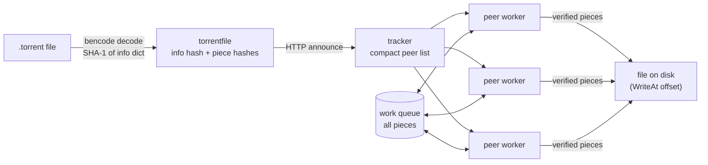

# ⚡ mini-bittorrent

<p align="center">
  
  
  <a href="https://github.com/AMINA-ELHASNAOUY/mini-bittorrent/actions/workflows/ci.yml"></a>
  
</p>

<p align="center">
  <i>A BitTorrent client written from the protocol spec in Go — standard library only, no torrent libraries.</i>
</p>

It reads a `.torrent` file, asks the tracker for peers, opens TCP connections to many of them at once,
downloads pieces in parallel, checks every piece against its SHA-1 hash, and drops peers that send corrupt data.

```text
$ mini-bittorrent demo
demo: local tracker + 4 seeders (one full, two partial, one sending corrupt data)
→ demo.bin (8.0 MiB, 32 pieces)
→ asking tracker http://127.0.0.1:44739/announce for peers…
→ tracker returned 4 peers
  15:08:41 peer 127.0.0.1:43615: piece 3 failed the hash check (1/3)
  15:08:41 peer 127.0.0.1:43615: piece 6 failed the hash check (2/3)
  15:08:41 peer 127.0.0.1:43615: piece 10 failed the hash check (3/3)
  15:08:41 peer 127.0.0.1:43615: dropped for sending corrupt data
  [██████████████████████████████] 100.0%  32/32 pieces  3 peers
✓ saved /tmp/mini-bittorrent-demo…/demo.bin, all 32 pieces SHA-1 verified (8.0 MiB in 840ms, 9.5 MiB/s)
✓ byte-for-byte identical to the original
```

## Quick start

```bash
git clone https://github.com/AMINA-ELHASNAOUY/mini-bittorrent.git
cd mini-bittorrent
go build -o mini-bittorrent .

./mini-bittorrent demo                      # full download from a local swarm, no internet needed
./mini-bittorrent info     file.torrent     # inspect a .torrent
./mini-bittorrent download file.torrent     # download it (-o to choose the output path, -v for peer logs)
```

To try it on the real network, use a single-file torrent with an HTTP tracker — for example a
[Debian netinst image](https://www.debian.org/CD/torrent-cd/) `.iso.torrent`.

## How it works



| Package | What it does | Spec |
|---|---|---|
| `bencode` | Encoder/decoder for BitTorrent's binary serialization format | [BEP 3](https://www.bittorrent.org/beps/bep_0003.html) |
| `torrentfile` | Parses `.torrent` metadata and computes the info hash that identifies the torrent | BEP 3 |
| `tracker` | HTTP announce request, compact and dictionary peer lists | BEP 3, [BEP 23](https://www.bittorrent.org/beps/bep_0023.html) |
| `peer` | Handshake, length-prefixed wire messages, bitfields, the per-peer connection | BEP 3 |
| `download` | Concurrent piece scheduler, request pipelining, hash verification | — |
| `internal/localswarm` | Local tracker + seeders used by the tests and `demo` | — |

## Design decisions

- **One goroutine per peer, one shared work queue.** Every piece starts on a buffered channel. A worker takes a piece; if its peer doesn't have it, fails mid-transfer, or sends data that fails the hash check, the piece goes back on the queue for another peer. Nothing is ever lost when a peer disappears.
- **Request pipelining.** Each worker keeps up to 5 block requests (16 KiB each) in flight instead of waiting for every reply — round-trip latency, not bandwidth, is what limits a single connection.
- **Never trust a peer.** Every piece is SHA-1 checked before it is written. A peer that sends 3 corrupt pieces is disconnected. Incoming lengths, indexes and block offsets are bounds-checked, and bencoded string lengths are capped so a malicious length prefix can't force a huge allocation.
- **Safe output.** Pieces are written with `WriteAt` straight to their offset in a `.part` file, so memory stays flat regardless of file size. The file is renamed only after a final full re-verification.
- **Testable without the internet.** `internal/localswarm` runs a real HTTP tracker and real peer-wire seeders on `127.0.0.1`, so the full path from announce to verified file is covered by tests.

## Tests

```bash
go test -race ./...
```

30 tests, run in CI with the race detector. The end-to-end tests in `download/` cover:
- a full download with an uneven last piece and last block
- a file split across two partial seeders (even pieces on one, odd on the other)
- two corrupt seeders + one honest one: every bad piece is rejected, retried elsewhere, and the result verifies
- only corrupt seeders: the download fails cleanly instead of hanging

## Limitations

Being upfront about scope:
- Single-file torrents only (multi-file torrents are rejected with a clear error)
- HTTP/HTTPS trackers only — no UDP trackers ([BEP 15](https://www.bittorrent.org/beps/bep_0015.html)), magnet links or DHT
- Download only: it does not seed back to the swarm, and an interrupted download restarts from zero

## Roadmap

- [ ] Multi-file torrents
- [ ] UDP tracker protocol (BEP 15) — most public torrents use it
- [ ] Resume from a partial `.part` file
- [ ] Seeding / upload support
- [ ] Rarest-first piece selection

## License

MIT — see [LICENSE](LICENSE).

---

<p align="center"><sub>Built by <a href="https://github.com/AMINA-ELHASNAOUY">Amina Elhasnaouy</a></sub></p>
